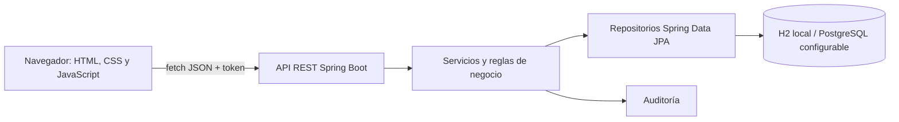

# Arquitectura y decisiones de alcance

## Componentes

El frontend consume la API mediante `fetch`. La API valida datos, rol y transiciones; la base conserva usuarios, roles, categorías, equipos, solicitudes, decisiones, préstamos, novedades y auditoría. Los cambios de disponibilidad se deciden en el backend, también cuando una petición llega directamente a la API.

## Ciclo principal

1. Un estudiante o docente consulta un equipo `DISPONIBLE` y crea una solicitud `PENDIENTE` con inicio, fin y motivo. El backend comprueba que la duración entre esas fechas no supere el máximo del perfil.
2. El encargado aprueba o rechaza y deja fecha, identidad y observación. Antes de aprobar se revalida el plazo según el rol actual del titular. Una aprobación reserva el equipo mientras se concreta la entrega.
3. Solo una solicitud `APROBADA` se puede entregar. El plazo se revalida de nuevo; después se crea un préstamo `ACTIVO` y el equipo pasa a `PRESTADO`.
4. El encargado registra devolución, condición y eventuales novedades. `BUENO` deja préstamo `DEVUELTO` y equipo `DISPONIBLE`; `NOVEDAD` no crítica deja préstamo `DEVUELTO_CON_NOVEDAD` y equipo `DISPONIBLE`; `DANADO` deja préstamo `DEVUELTO_CON_NOVEDAD` y equipo `MANTENIMIENTO`.
5. Historial y auditoría permanecen consultables después de la devolución.

Estados previstos por el documento: equipo `DISPONIBLE`, `RESERVADO`, `PRESTADO`, `MANTENIMIENTO`, `INACTIVO`; solicitud `PENDIENTE`, `APROBADA`, `RECHAZADA`, `CANCELADA`, `VENCIDA`; préstamo `ACTIVO`, `DEVUELTO`, `DEVUELTO_CON_NOVEDAD`.

## Seguridad y persistencia

- Inicio de sesión local con JWT HMAC; las contraseñas se almacenan como hash.
- Los roles `ADMINISTRADOR`, `ENCARGADO`, `ESTUDIANTE` y `DOCENTE` limitan operaciones en backend. Estudiantes y docentes comparten permisos de solicitante, pero tienen plazos máximos distintos. El catálogo público puede exponerse sin inicio de sesión.
- En desarrollo se usa H2 para una ejecución reproducible. PostgreSQL se configura mediante variables de entorno para un despliegue persistente.
- Entidades con claves primarias y foráneas, código de equipo único y relación de un préstamo como máximo por solicitud.
- Errores JSON con `error` y `message`; códigos HTTP acordes al resultado.

## Decisiones para puntos abiertos del documento

| Tema | Decisión del proyecto |
| --- | --- |
| Cantidad de equipos por solicitud | Uno. HU-05 y el ER usan `id_equipo` por solicitud, aunque la definición general diga “uno o varios”. |
| Autenticación | JWT sencillo con sesión sin estado en el backend. |
| Caducidad de aprobaciones | 48 horas configurables desde la decisión si no hay entrega. |
| Duración máxima por perfil | 7 días para `ESTUDIANTE` y 30 para `DOCENTE`, calculados como diferencia entre `fechaFin` y `fechaInicio`, configurables con `APP_MAX_DIAS_ESTUDIANTE` y `APP_MAX_DIAS_DOCENTE`. Esta regla amplía el documento por solicitud del usuario. |
| Datos existentes | Los usuarios con rol anterior `SOLICITANTE` se migran a `ESTUDIANTE` al iniciar, preservando solicitudes, préstamos e historial. El rol antiguo queda solo para reconocer datos previos; se rechaza en nuevas cuentas. |
| Visitantes | Consulta del catálogo público; no pueden solicitar ni ver datos personales. |
| Cobros, lectores físicos, contabilidad e integración institucional | Fuera de alcance, según sección 1.2 del documento. |

La arquitectura toma como referencia el documento académico. Los detalles precisos de rutas, configuración y comandos se mantienen en el [README](../README.md).
