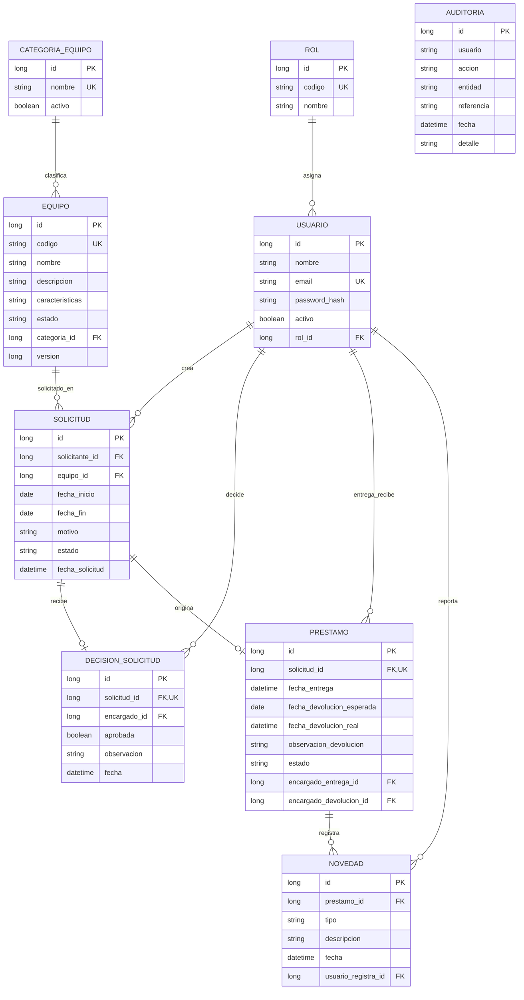

# Modelo de datos lógico

El esquema lo genera JPA a partir de las entidades de `src/main/java/co/edu/uniajc/prestamos/model/`. En desarrollo H2 conserva los datos en archivo; el perfil PostgreSQL usa las mismas entidades.

`AUDITORIA` almacena el identificador legible del actor y los datos de la acción como registro histórico; no depende de una FK a `USUARIO`. La tabla `PRESTAMO` guarda dos referencias a usuario, encargado de entrega y de devolución, resumidas en el diagrama.

## Restricciones importantes

- `USUARIO.email`, `CATEGORIA_EQUIPO.nombre` y `EQUIPO.codigo` son únicos.
- `DECISION_SOLICITUD.solicitud_id` y `PRESTAMO.solicitud_id` son únicos: cada solicitud tiene como máximo una decisión y un préstamo.
- Las claves foráneas impiden préstamos, solicitudes o novedades sin sus registros relacionados.
- Un equipo con historial se inactiva; no se borra. El historial de préstamos persiste tras devolverlo.
- La aplicación comprueba fechas y disponibilidad en servicios transaccionales. El estado actual del equipo y la unicidad por solicitud sustentan la regla de un solo préstamo activo por equipo.
- `ROL.codigo` distingue `ESTUDIANTE` y `DOCENTE`. El límite de días se calcula al crear la solicitud a partir del rol del usuario y de la configuración del ambiente; no se almacena una copia del límite en cada solicitud. Los registros históricos mantienen sus fechas originales.
- Las cuentas anteriores con `SOLICITANTE` se reasignan a `ESTUDIANTE` en la migración de inicio. Las relaciones de `USUARIO` con solicitudes y préstamos no cambian.
